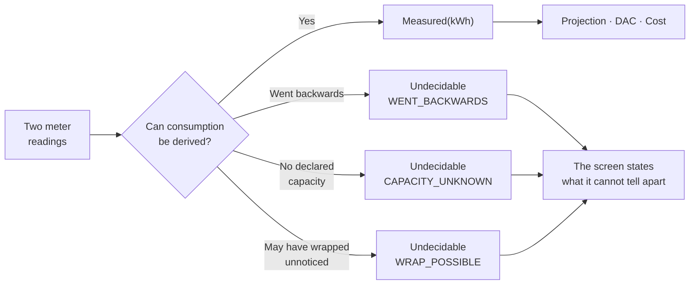
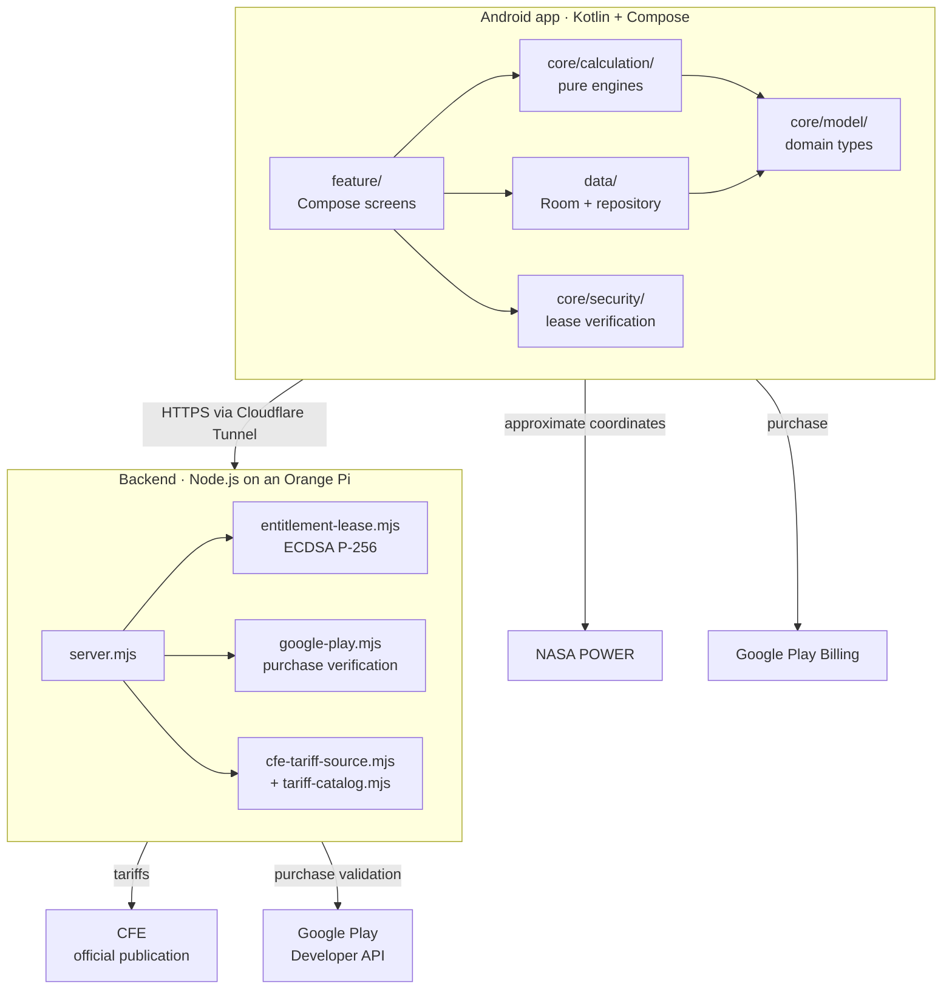

# ReciboZen

[Leer en español](README.md)

Android app for household electricity customers of CFE in Mexico. It projects the cost of the next bill, warns before the user falls into the DAC high-consumption tariff, and explains where every number comes from.

> **ReciboZen is an independent project.** It does not represent, and is not affiliated with or endorsed by, the Comision Federal de Electricidad (CFE) or any government entity. Tariffs come from [CFE's official publication](https://app.cfe.mx/Aplicaciones/CCFE/Tarifas/TarifasCREHogar/Tarifas). Amounts are estimates meant as guidance; the real bill is determined by CFE.

## Contents

- [The principle behind this code](#the-principle-behind-this-code)
- [Features](#features)
- [Architecture](#architecture)
- [Stack](#stack)
- [Privacy](#privacy)
- [Build and verify](#build-and-verify)
- [Backend](#backend)
- [Documentation](#documentation)
- [Status](#status)
- [License](#license)

---

## The principle behind this code

Almost every electricity-usage app fills in the gaps: if it does not know your tariff, it assumes one; if months of history are missing, it averages what is there; if two sources disagree, it takes the mean. ReciboZen does not.

**The rule is that data which cannot be honestly derived is not invented: it is declared unknown.** This is not an aspiration written in a document. It is a constraint the code enforces and the tests lock in.

Four examples, all verifiable:

| Where | What it does instead of guessing |
|---|---|
| [`DacRisk.kt`](app/src/main/java/app/recibozen/android/core/calculation/DacRisk.kt) | Without a substantially complete rolling year, the level is `UNKNOWN`. It issues no DAC verdict from partial history, even when the trend is clear |
| [`MeterDelta.kt`](app/src/main/java/app/recibozen/android/core/calculation/MeterDelta.kt) | If the meter may have rolled over, it returns `Undecidable` with the possible interpretations. **It never applies a rollover on its own** |
| [`EvidenceResolver.kt`](app/src/main/java/app/recibozen/android/core/calculation/EvidenceResolver.kt) | Two contradicting sources are **never averaged**. An average is a number nobody asserted with the authority of both |
| [`MeterReadingParser.kt`](app/src/main/java/app/recibozen/android/core/ocr/MeterReadingParser.kt) | If a photo admits two credible readings, it returns `null`. It used to pick the one closest to the previous reading, and once returned a homologation code from the nameplate |

The corollary in the interface: where there is no data, a dash is shown, not a zero. A zero is a real measurement, and confusing it with "I don't know" is the same lie, harder to detect.



---

## Features

- **Bill projection** from meter readings, with daily pace and likely range.
- **DAC tariff prevention**: margin within the rolling 365-day window, how many kWh leave that window in the next bill, and the recommended maximum for the next two periods.
- **Bill change explanation**: breaks the difference down into days, consumption, excess tier and season.
- **Appliance inventory** with the provenance and confidence level of each data point.
- **Meter reading** by dial (one dial at a time), manually or from a photo with on-device OCR.
- **Bill import** from PDF or photo.
- **Solar pre-study** using NASA POWER irradiation data.

---

## Architecture



**The calculation engines do not depend on Android.** They are plain Kotlin: no `Context`, no Compose, no coroutines. That is why they are tested with JUnit on the JVM, in seconds.

### Structure

```
app/src/main/java/app/recibozen/android/
├── core/
│   ├── calculation/     pure calculation engines (19 source files)
│   ├── model/           domain types
│   ├── security/        entitlement verification
│   ├── components/      design system components
│   ├── designsystem/    color, typography, spacing
│   ├── ocr/             meter reading from recognized text
│   ├── importer/        CFE bill parsing (PDF and photo)
│   └── notifications/   reading reminders via WorkManager
├── feature/             Compose screens
├── data/                Room + persistent repository
└── demo/                in-memory repository for previews and tests

backend/src/             6 Node.js modules, no external dependencies
docs/                    architecture, operations, publishing, AI plan
```

### Calculation engines

| Engine | What it solves |
|---|---|
| `DacRisk.kt` | Rolling 365-day window with overlap proration, annualization over gaps, per-tariff limit |
| `TariffEngine.kt` | Tariff tiers and total cost |
| `TariffCalibration.kt` | Adjusts rates against a real imported bill |
| `MeterDelta.kt` | Consumption between two readings: rollover, multiplier, implausible rates |
| `MeterProfile.kt` | Meter capacity and dials from the declared type |
| `EvidenceResolver.kt` | Resolves contradicting data sources without averaging them |
| `BillChangeExplainer.kt` | Breaks down the difference between two bills |
| `ConsumptionPace.kt` | Daily pace and end-of-period projection |
| `OvernightBaseline.kt` | Nighttime baseline consumption to detect phantom loads |
| `SolarEstimator.kt` | Solar scenarios using real irradiation |
| `ApplianceAdvice.kt` | Per-appliance recommendations with quantified savings |

---

## Stack

| | |
|---|---|
| Language | Kotlin 2.2.10 |
| UI | Jetpack Compose (BOM 2026.02.01), Material 3 |
| Build | AGP 9.4.1 · Gradle |
| SDK | `targetSdk` 37 · `minSdk` 28 |
| Persistence | Room 2.8.4 + DataStore |
| Background work | WorkManager |
| OCR | ML Kit Text Recognition, **on device** (bundled model) |
| Payments | Google Play Billing 9.1.0 + Play Integrity |
| Backend | Node.js with no third-party dependencies · Docker · Cloudflare Tunnel |

No analytics, no advertising, no tracking SDKs. None.

---

## Privacy

Bills, readings, appliances and photos are stored **only on the device**. There is no user account or password. `allowBackup="false"`: the data is not copied to Google's backup either.

The only things that leave the phone:

| Data | Destination | Why |
|---|---|---|
| None (tariff download only) | CFE (via backend) | Downloads published tariffs. Nothing from the user is sent |
| Approximate city coordinates | NASA POWER | Solar irradiation, only if you use the pre-study |
| Purchase token + installation identifier | Own backend | Validate the subscription with Google Play |

Meter OCR runs **offline**: the photo is never uploaded. The backend persists no user data; the only thing it writes to disk is the tariff catalog.

[Full privacy policy](https://tandemrhombus.github.io/recibozen-legal/)

---

## Build and verify

```bash
./gradlew testDebugUnitTest          # Android unit tests
./gradlew assembleDebug lintDebug    # debug APK + lint
./gradlew bundleRelease              # signed AAB for Play
```

```bash
cd backend && node --test            # backend tests
```

The repository contains 415 `@Test` cases across 51 Android test files, and 22 backend test cases.

A signed release requires a `keystore.properties` file at the root (git-ignored):

```properties
storeFile=recibozen-upload.jks
storePassword=...
keyAlias=recibozen
keyPassword=...
```

> With PKCS12 keystores (the default format since JDK 9), `keyPassword` **must be identical** to `storePassword`, or signing fails with `Given final block not properly padded`.

---

## Backend

Six Node.js modules with no third-party dependencies, running in Docker on an Orange Pi and published through a Cloudflare Tunnel. The container runs as an unprivileged user, with a read-only filesystem and all capabilities dropped.

| Endpoint | What it does |
|---|---|
| `GET /healthz` | Liveness |
| `GET /readyz` | Readiness, including whether Play Billing is configured |
| `GET /v1/tariffs/current` | Current tariff catalog |
| `GET /v1/solar/resource/{lat}/{lon}` | Cached solar resource |
| `POST /v1/entitlements/exchange` | Validates the purchase with Google Play and issues a signed lease |
| `GET /.well-known/recibozen-entitlement-key` | Public key to verify leases |

The *entitlement lease* is signed with **ECDSA P-256** on the server and verified on the client ([`EntitlementLeaseVerifier.kt`](app/src/main/java/app/recibozen/android/core/security/EntitlementLeaseVerifier.kt)). The private key never leaves the server.

```bash
# The billing overlay is mandatory: without it the API returns 503 again
docker compose -f compose.yaml -f compose.billing.yaml up -d --no-deps api
```

Operational details in [`docs/BACKEND_OPERATIONS.md`](docs/BACKEND_OPERATIONS.md).

---

## Documentation

The documents below are written in Spanish.

| Document | Content |
|---|---|
| [`docs/ARQUITECTURA.md`](docs/ARQUITECTURA.md) | Flow diagrams, decisions and invariants |
| [`docs/BACKEND_OPERATIONS.md`](docs/BACKEND_OPERATIONS.md) | Deployment, secrets, checks |
| [`docs/COMO_PUBLICAR.md`](docs/COMO_PUBLICAR.md) | Signing, test tracks, Play requirements |
| [`docs/SECURITY_HARDENING.md`](docs/SECURITY_HARDENING.md) | Threat model of the premium layer |
| [`docs/PLAN_IA.md`](docs/PLAN_IA.md) | Design of the AI proxy and its hardening |
| [`docs/REFERENCE_DATA_FORMAT.md`](docs/REFERENCE_DATA_FORMAT.md) | Contract for adding researched tariffs and appliances |

---

## Status

In closed testing on Google Play. The Plus subscription exists in the console, but **the paywall is deliberately unlocked** ([`Paywall.kt`](app/src/main/java/app/recibozen/android/core/model/Paywall.kt)): while purchasing is not possible, locking features would take capabilities away from everyone without charging anyone. It is re-enabled in the same release that activates the base plans.

Known open items, stated honestly:

- CFE's multiplier is not applied to consumption derived from readings, although it is applied to imported bills.
- When a reading goes backwards, the app states the ambiguity but does not yet ask the user which of the four situations occurred.
- The typography is the system one by decision; each layout still needs to be verified at large font scale.

---

## License

All rights reserved. The source code is visible, but no permission is granted to use, copy or modify it. See [`LICENSE`](LICENSE).
