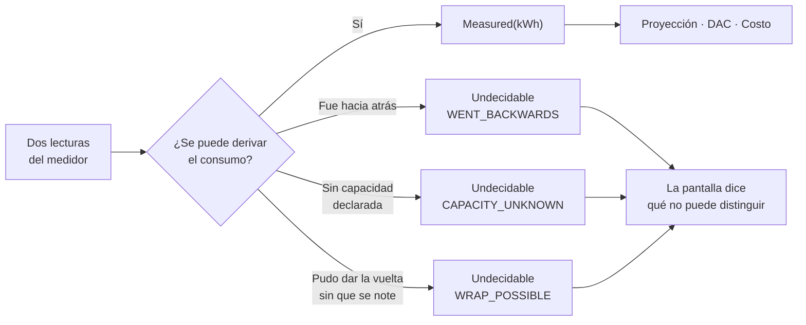
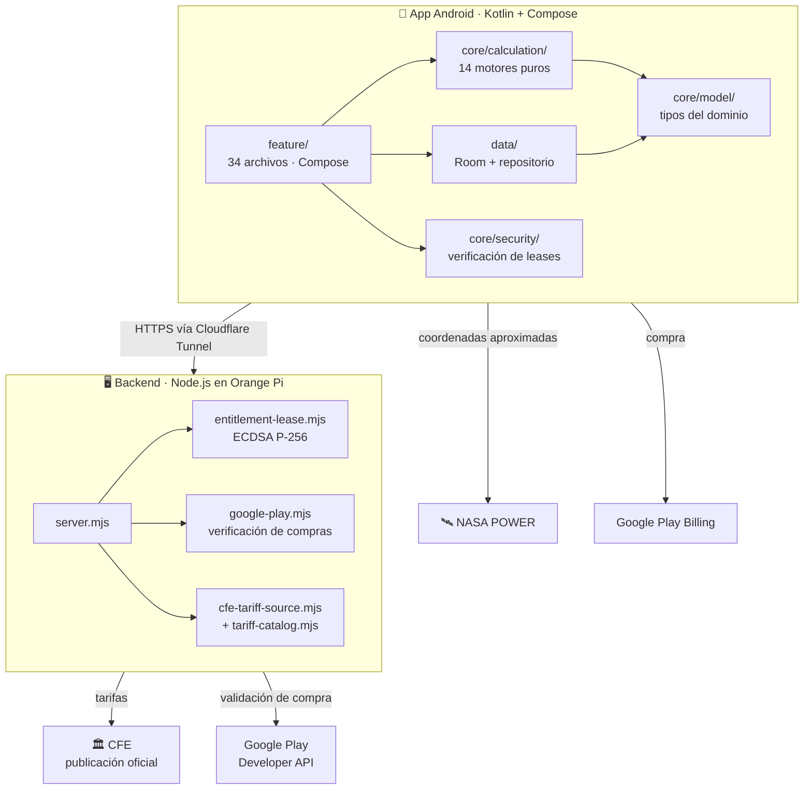

# ReciboZen

Aplicación Android para consumidores domésticos de CFE en México. Calcula cuánto va a costar el próximo recibo, avisa antes de caer en la tarifa DAC y explica de dónde sale cada número.

> **ReciboZen es un proyecto independiente.** No representa, no está afiliado ni respaldado por la Comisión Federal de Electricidad ni por ninguna entidad gubernamental. Las tarifas provienen de la [publicación oficial de CFE](https://app.cfe.mx/Aplicaciones/CCFE/Tarifas/TarifasCREHogar/Tarifas). Los montos son estimaciones para orientar; el recibo real lo determina CFE.

---

## El principio que gobierna este código

Casi cualquier app de consumo eléctrico rellena los huecos: si no sabe tu tarifa, asume una; si le faltan meses de historial, promedia lo que hay; si dos fuentes se contradicen, saca la media. ReciboZen no.

**La regla es que un dato que no se puede derivar honestamente no se inventa: se declara desconocido.** No es una aspiración escrita en un documento, es una restricción que el código impone y las pruebas fijan.

Cuatro ejemplos, todos verificables:

| Dónde | Qué hace en vez de adivinar |
|---|---|
| [`DacRisk.kt`](app/src/main/java/app/recibozen/android/core/calculation/DacRisk.kt) | Sin un año móvil sustancialmente completo, el nivel es `UNKNOWN`. No emite veredicto de DAC con historial parcial, aunque la tendencia sea clara |
| [`MeterDelta.kt`](app/src/main/java/app/recibozen/android/core/calculation/MeterDelta.kt) | Si el medidor pudo haber dado la vuelta, devuelve `Undecidable` con las interpretaciones posibles. **Nunca aplica una vuelta por su cuenta** |
| [`EvidenceResolver.kt`](app/src/main/java/app/recibozen/android/core/calculation/EvidenceResolver.kt) | Dos fuentes que se contradicen **jamás se promedian**. Un promedio es un número que nadie afirmó con la autoridad de ambos |
| [`MeterReadingParser.kt`](app/src/main/java/app/recibozen/android/core/ocr/MeterReadingParser.kt) | Si la foto admite dos lecturas creíbles, devuelve `null`. Antes elegía la más cercana a la anterior y llegó a devolver un código de homologación de la placa |

El corolario en la interfaz: donde no hay dato, se muestra una raya, no un cero. Un cero es una medición real y confundirlo con "no sé" es la misma mentira, más difícil de detectar.



---

## Qué hace

- **Proyección del recibo** a partir de lecturas del medidor, con el ritmo diario y el rango probable.
- **Prevención de tarifa DAC**: margen en la ventana móvil de 365 días, cuántos kWh salen de esa ventana en el próximo recibo y el máximo recomendado para los dos periodos siguientes.
- **Explicación del cambio de recibo**: descompone la diferencia en días, consumo, escalón excedente y temporada.
- **Inventario de aparatos** con la procedencia de cada dato y su nivel de confianza.
- **Lectura del medidor** por manecillas (carátula por carátula), manual o foto con OCR en dispositivo.
- **Importación de recibos** en PDF o foto.
- **Preestudio solar** con datos de irradiación de NASA POWER.

---

## Arquitectura



**Los motores de cálculo no dependen de Android.** Son Kotlin puro, sin `Context`, sin Compose, sin corrutinas. Por eso se prueban con JUnit en la JVM y por eso las 268 pruebas corren en segundos.

### Estructura

```
app/src/main/java/app/recibozen/android/
├── core/
│   ├── calculation/     14 motores puros · 2,371 líneas
│   ├── model/            8 tipos del dominio · 474 líneas
│   ├── security/         4 archivos · verificación de entitlements
│   ├── components/      12 componentes del design system
│   ├── designsystem/     6 archivos · color, tipografía, espaciado
│   ├── ocr/              lectura de medidor desde texto reconocido
│   ├── importer/         parseo de recibos CFE (PDF y foto)
│   └── notifications/    recordatorios de lectura vía WorkManager
├── feature/             34 pantallas Compose · 14,149 líneas
├── data/                Room + repositorio persistente · 1,913 líneas
└── demo/                repositorio en memoria para previews y pruebas

backend/src/             6 módulos Node.js sin dependencias externas
docs/                    arquitectura, operación, publicación, plan de IA
```

### Motores de cálculo

| Motor | Qué resuelve |
|---|---|
| `DacRisk.kt` | Ventana móvil de 365 días con prorrateo por traslape, anualización ante huecos, límite por tarifa |
| `TariffEngine.kt` | Escalones tarifarios y costo total |
| `TariffCalibration.kt` | Ajusta las cuotas contra un recibo real importado |
| `MeterDelta.kt` | Consumo entre dos lecturas: desbordamiento, multiplicador, tasas implausibles |
| `MeterProfile.kt` | Capacidad y carátulas del medidor a partir del tipo declarado |
| `EvidenceResolver.kt` | Resuelve fuentes de datos que se contradicen sin promediarlas |
| `BillChangeExplainer.kt` | Descompone la diferencia entre dos recibos |
| `ConsumptionPace.kt` | Ritmo diario y proyección al cierre |
| `OvernightBaseline.kt` | Consumo base nocturno para detectar cargas fantasma |
| `SolarEstimator.kt` | Escenarios solares con irradiación real |
| `ApplianceAdvice.kt` | Recomendaciones por aparato con ahorro cuantificado |

---

## Stack

| | |
|---|---|
| Lenguaje | Kotlin 2.2.10 |
| UI | Jetpack Compose (BOM 2026.02.01), Material 3 |
| Build | AGP 9.3.1 · Gradle · JVM 11 |
| SDK | `compileSdk`/`targetSdk` 37 · `minSdk` 28 |
| Persistencia | Room 2.8.4 (9 entidades) + DataStore |
| Trabajos en segundo plano | WorkManager |
| OCR | ML Kit Text Recognition **en dispositivo** (modelo empaquetado) |
| Pagos | Google Play Billing 9.1.0 + Play Integrity |
| Backend | Node.js sin dependencias de terceros · Docker · Cloudflare Tunnel |

Sin analítica, sin publicidad, sin SDKs de rastreo. Ninguno.

---

## Privacidad

Los recibos, lecturas, aparatos y fotos se guardan **solo en el dispositivo**. No hay cuenta de usuario ni contraseña. `allowBackup="false"`: los datos tampoco se copian al respaldo de Google.

Lo único que sale del teléfono:

| Dato | Destino | Por qué |
|---|---|---|
| — | CFE (vía backend) | Descarga de tarifas publicadas. No envía nada del usuario |
| Coordenadas aproximadas de la ciudad | NASA POWER | Irradiación solar, solo si usas el preestudio |
| Token de compra + identificador de instalación | Backend propio | Validar la suscripción con Google Play |

El OCR del medidor corre **sin conexión**: la foto nunca se sube. El backend no persiste ningún dato de usuario — lo único que escribe en disco es el catálogo de tarifas.

[Política de privacidad completa](https://tandemrhombus.github.io/recibozen-legal/)

---

## Compilar y verificar

```bash
./gradlew testDebugUnitTest          # 268 pruebas unitarias
./gradlew assembleDebug lintDebug    # APK de depuración + lint
./gradlew bundleRelease              # AAB firmado para Play
```

```bash
cd backend && node --test            # 21 pruebas del backend
```

Para generar un release firmado hace falta un `keystore.properties` en la raíz (git-ignorado):

```properties
storeFile=recibozen-upload.jks
storePassword=…
keyAlias=recibozen
keyPassword=…
```

> Con almacenes PKCS12 —el formato por defecto desde JDK 9— `keyPassword` **tiene que ser idéntica** a `storePassword`, o la firma falla con `Given final block not properly padded`.

### Estado de verificación

| | |
|---|---|
| Pruebas unitarias Android | **268 · 0 fallos** (38 archivos de prueba) |
| Pruebas del backend | **21 · 0 fallos** |
| Lint | 0 errores |
| Cadenas de texto sin usar | 0 |

---

## Backend

Seis módulos Node.js sin dependencias de terceros, en Docker sobre una Orange Pi, publicados por Cloudflare Tunnel. El contenedor corre como usuario sin privilegios, con sistema de archivos de solo lectura y todas las capabilities eliminadas.

| Endpoint | Qué hace |
|---|---|
| `GET /healthz` | Vivo |
| `GET /readyz` | Listo, incluye si Play Billing está configurado |
| `GET /v1/tariffs/current` | Catálogo de tarifas vigente |
| `GET /v1/solar/resource/{lat}/{lon}` | Recurso solar con caché |
| `POST /v1/entitlements/exchange` | Valida la compra con Google Play y emite un lease firmado |
| `GET /.well-known/recibozen-entitlement-key` | Clave pública para verificar leases |

El *entitlement lease* se firma con **ECDSA P-256** en el servidor y se verifica en el cliente ([`EntitlementLeaseVerifier.kt`](app/src/main/java/app/recibozen/android/core/security/EntitlementLeaseVerifier.kt)). La clave privada nunca sale del servidor.

```bash
# El overlay de billing es obligatorio: sin él la API vuelve a 503
docker compose -f compose.yaml -f compose.billing.yaml up -d --no-deps api
```

Detalles de operación en [`docs/BACKEND_OPERATIONS.md`](docs/BACKEND_OPERATIONS.md).

---

## Documentación

| Documento | Contenido |
|---|---|
| [`docs/ARQUITECTURA.md`](docs/ARQUITECTURA.md) | Diagramas de flujo, decisiones e invariantes |
| [`docs/BACKEND_OPERATIONS.md`](docs/BACKEND_OPERATIONS.md) | Despliegue, secretos, comprobaciones |
| [`docs/COMO_PUBLICAR.md`](docs/COMO_PUBLICAR.md) | Firma, canales de prueba, requisitos de Play |
| [`docs/SECURITY_HARDENING.md`](docs/SECURITY_HARDENING.md) | Modelo de amenazas de la capa premium |
| [`docs/PLAN_IA.md`](docs/PLAN_IA.md) | Diseño del proxy de IA y su blindaje |
| [`docs/REFERENCE_DATA_FORMAT.md`](docs/REFERENCE_DATA_FORMAT.md) | Contrato para incorporar tarifas y aparatos investigados |

---

## Estado

En preparación para prueba cerrada en Google Play. La suscripción Plus existe en la consola pero **el candado está levantado a propósito** ([`Paywall.kt`](app/src/main/java/app/recibozen/android/core/model/Paywall.kt)): mientras no se pueda comprar, bloquear funciones le quitaría capacidades a todos sin cobrarle a nadie. Se reactiva en la misma versión que active los planes base.

Pendientes conocidos y honestos:

- El multiplicador de CFE no se aplica a consumos derivados de lecturas, aunque sí a los recibos importados.
- Cuando una lectura va hacia atrás, la app enuncia la ambigüedad pero todavía no le pregunta al usuario cuál de las cuatro situaciones ocurrió.
- La tipografía es la del sistema por decisión; falta verificar cada layout con escala de fuente grande.

---

## Licencia

Sin licencia pública. Todos los derechos reservados.
