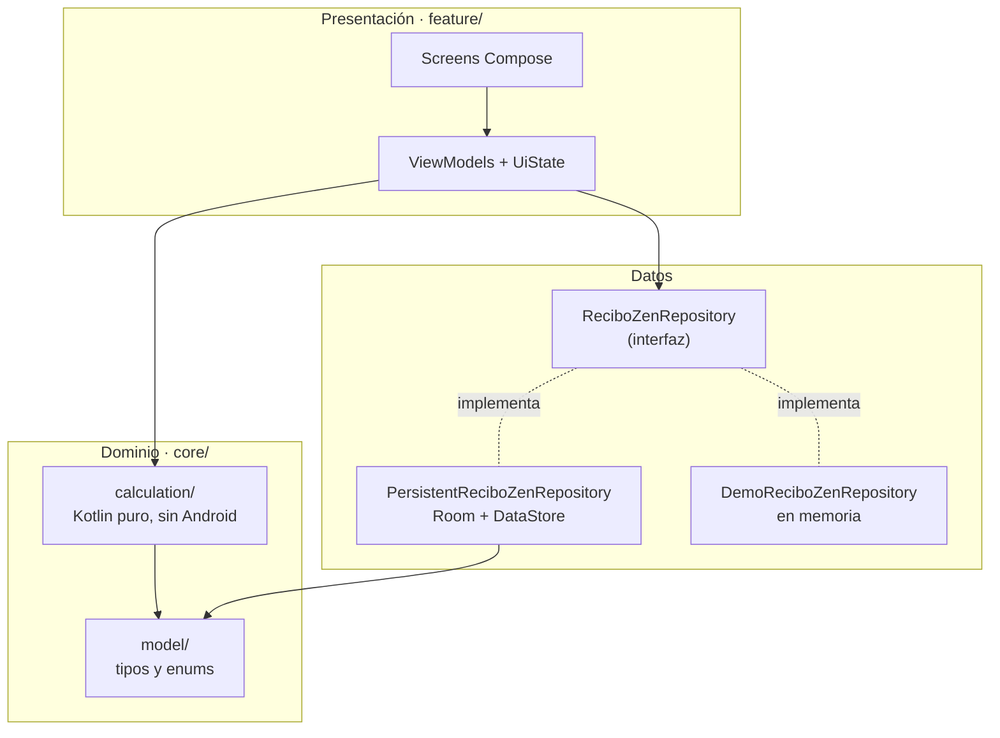
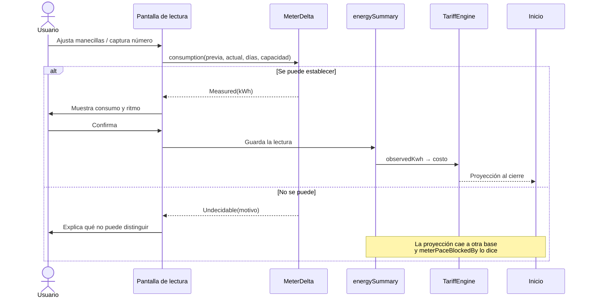
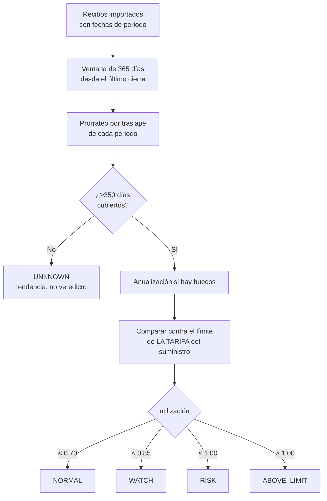
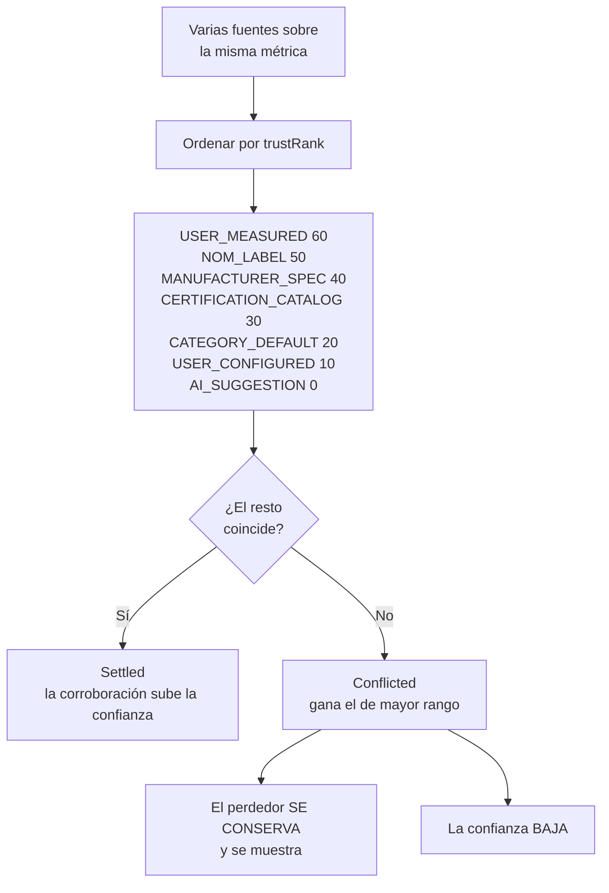
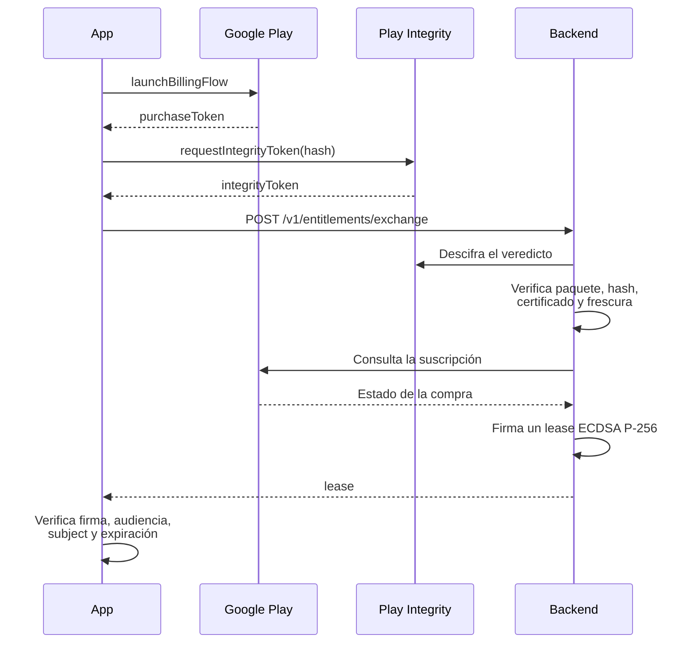

# Arquitectura

Este documento explica **por qué** el código está organizado como está. Para qué hace la app, ver el [README](../README.md).

---

## 1. La invariante que define el diseño

Todo lo demás se deriva de esto:

> **Un dato que no se puede establecer honestamente no se rellena: se declara desconocido, y la pantalla dice por qué.**

Suena a lema. En la práctica es una restricción de tipos.

La forma habitual de modelar "consumo entre dos lecturas" es un `Int`. Ese tipo **no puede representar "no sé"**, así que cuando el cálculo falla hay que inventar un valor centinela: un `0`, un negativo, un `-1`. Todos mienten, y el peor es el `0`, porque cero es un consumo real —una casa vacía consume cero— y confundirlo con "desconocido" produce un error indetectable.

Por eso los motores devuelven tipos que **hacen imposible** ese estado:

```kotlin
sealed interface MeterDelta {
    data class Measured(val kwh: Int, val wraps: Int, val multiplier: Int) : MeterDelta
    data class Undecidable(val reason: Reason, val candidates: List<Candidate>) : MeterDelta
}
```

El consumidor no puede leer `kwh` sin antes decidir qué hace cuando no lo hay. El compilador lo obliga.

El mismo patrón, tres veces más:

| Tipo | Variante honesta | Archivo |
|---|---|---|
| `DacRiskLevel` | `UNKNOWN` cuando el año móvil está incompleto | `core/calculation/DacRisk.kt` |
| `EvidenceResolution` | `Conflicted` conserva al perdedor en vez de promediar | `core/calculation/EvidenceResolver.kt` |
| `DacGlanceKind` | `NO_VERDICT` gana sobre cualquier otro nivel | `feature/plan/DacGlance.kt` |

### Corolarios en la interfaz

- Donde no hay dato se muestra `—`, nunca `0` ni `null`.
- Un fallback siempre dice que es un fallback. Si la proyección no pudo usar el medidor, `EnergySummary.meterPaceBlockedBy` lleva el motivo hasta la pantalla de Inicio.
- Una estimación nunca se presenta como medición. `DeviceEvidence` deriva la confianza en vez de dejar que alguien la declare.

---

## 2. Capas



**La dirección de las dependencias no se rompe nunca:** presentación → dominio → nada. `core/calculation` no importa Compose, ni `Context`, ni corrutinas. Esa es la razón de que 268 pruebas corran en la JVM en segundos, sin emulador.

`DemoReciboZenRepository` no es un mock de pruebas: es la implementación base que `PersistentReciboZenRepository` extiende (`open override`). Sirve a las previews de Compose y hace que la lógica de sesión se escriba una sola vez.

---

## 3. Flujo: de una lectura al recibo proyectado



El punto no obvio: **la rama de la derecha también es un resultado válido del producto**, no un error. La app sigue funcionando, con otra base de proyección, y lo declara.

---

## 4. Prevención DAC

El cálculo más delicado de la app, porque un veredicto equivocado asusta a alguien que está bien o tranquiliza a alguien que no.



Cuatro decisiones deliberadas:

1. **El límite es por tarifa, no universal.** CFE asigna tarifas 1, 1A…1F según la temperatura de la localidad, y cada una tiene su propio límite. Un límite genérico da veredictos falsos en medio país.
2. **La ventana es móvil, no un año calendario.** Al entrar un recibo salen los días más viejos. El margen no se reinicia en enero, y la app lo explica en vez de dejar que el usuario lo suponga.
3. **Los periodos se prorratean por traslape.** Un bimestre que cae mitad dentro y mitad fuera aporta la mitad, no todo ni nada.
4. **`ABOVE_LIMIT` no es DAC.** Estar por encima significa que CFE *podría* reclasificar en su propia evaluación. La pantalla lo dice con esas palabras: quien reclasifica es CFE, no la app.

---

## 5. Procedencia de datos

Cuando varias fuentes describen el mismo aparato, hay que elegir sin inventar.



**`AI_SUGGESTION` tiene rango 0 a propósito.** Un modelo de lenguaje puede llenar los huecos que ENERGY STAR deja para marcas mexicanas (medido con `tools/ai-eval/verify_matcher.py` sobre los 9,305 modelos del catálogo: Mabe aporta 2, y Acros, IEM, Koblenz y Mirage cero), pero **nunca** debe sobrescribir una etiqueta que alguien leyó ni una medición que alguien tomó. Esa jerarquía se construyó antes que la IA, a propósito, para que la IA llegue a una casa con reglas.

**Nunca se promedia.** Un promedio entre 340 y 520 es 430: un número que ninguna fuente afirmó, presentado con la autoridad de las dos.

La confianza se **deriva** de la fuente, la metodología, la antigüedad y el ancho del rango. No hay setter. Si alguien pudiera estampar `HIGH` sobre una estimación modelada, volvería el defecto que todo esto existe para evitar.

---

## 6. Capa premium



Tres propiedades:

- **La clave privada nunca sale del servidor.** El cliente solo verifica; no puede fabricar un lease.
- **El lease está atado a la instalación** por su `subject`. Copiarlo a otro teléfono no sirve.
- **El backend no guarda nada del usuario.** Verifica, firma y responde. Lo único que escribe en disco es el catálogo de tarifas — por eso la app puede afirmar que no hay datos que eliminar del lado del servidor.

`AppInstallTrustChecker` exige además que **todos** los certificados con los que viene firmado el APK estén en la lista permitida (`.all`, no `.any`). Con Play App Signing eso son dos: la clave clásica y la poscuántica. Listar solo una hace que la app se rechace a sí misma en producción, en silencio — hay una prueba que impide que ese valor quede mal configurado.

---

## 7. Datos

Room, 9 entidades, versión 1:

```
households → electric_services → meters
                              └→ bills → bill_charges
                                      └→ bill_history_summaries

reference_datasets → appliance_references
                  └→ tariff_rate_references
```

Las tres tablas de referencia están versionadas y separadas de los datos del usuario: permiten incorporar tarifas y fichas de aparatos investigadas sin fijarlas dentro del APK. El contrato está en [`REFERENCE_DATA_FORMAT.md`](REFERENCE_DATA_FORMAT.md).

> `appliance_references` existe pero todavía no se alimenta. Está anotado como pendiente: o se llena o se quita.

---

## 8. Pruebas

38 archivos, 268 pruebas, todas en la JVM.

Lo que se prueba no es la cobertura, son **las invariantes**:

| Prueba | Qué impide que vuelva |
|---|---|
| `contradictingSourcesAreNeverAveraged` | Que un promedio se cuele como dato |
| `aSuggestionFromAModelNeverOverridesALabelSomebodyRead` | Que la IA pise una medición |
| `incompleteHistoryNeverClaimsTheUserWillEnterDac` | Un veredicto de DAC sin año completo |
| `noInputEverYieldsANegativeMeasurement` | Un consumo negativo con cara de medición |
| `aDialMeterFaceplateYieldsNoReadingBecauseThereAreNoDigitsToRead` | Que un código de la placa pase por lectura |
| `bothPlayAppSigningFingerprintsSurviveTheSameNormalisationTheAppApplies` | Que la app se rechace a sí misma por un typo |

Los nombres son frases porque el reporte de fallos se lee como una lista de promesas rotas.

**Regla al escribir pruebas:** primero se decide cuál *debería* ser el resultado, y después se corre. Una prueba ajustada para que pase deja de ser una prueba.

---

## 9. Decisiones que parecen bugs y no lo son

| Decisión | Por qué |
|---|---|
| `Type.kt` usa `FontFamily.Default` | Respeta la fuente y el tamaño que el usuario eligió en su teléfono. El costo aceptado: la app no se ve igual en todos lados. La consecuencia a probar: cada layout debe sobrevivir una escala de fuente grande |
| `Paywall.ENFORCED = false` | Mientras Plus no se pueda comprar, el candado quita funciones a todos y no cobra a nadie. Un solo flag gobierna todas las compuertas; las pruebas cubren ambos estados |
| El backend no persiste nada del usuario | Hace verdadera la afirmación de privacidad y elimina la superficie de una filtración |
| Los secretos son `640`, grupo `10001` | El contenedor corre como UID 10001; con `600` no los lee y entra en bucle de reinicio |

---

## 10. Qué falta

Honestamente, y sin adornos:

1. **El multiplicador de CFE no se aplica a consumos derivados de lecturas**, aunque la importación de recibos sí lo aplica. Afecta a servicios con transformador de corriente.
2. **Nadie le pregunta al usuario** cuál de las cuatro situaciones ocurrió cuando una lectura va hacia atrás. La ambigüedad se enuncia pero no se resuelve.
3. **Ningún layout se ha probado con escala de fuente grande**, que es la consecuencia directa de respetar la tipografía del sistema.
4. **No hay pruebas de UI de Compose.** Todo lo visual se verifica en dispositivo, a mano.
5. **`appliance_references` sigue vacía.**
